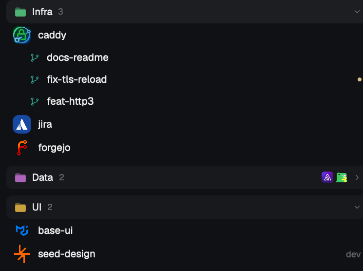
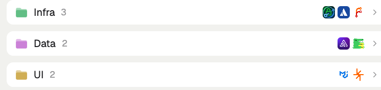

# Crest

A Spaces sidebar for [Herdr](https://herdr.dev). Each space shows its project's icon, and spaces sit in folders.

[](https://github.com/cmg8431/herdr-crest/releases/latest)
[](https://github.com/cmg8431/herdr-crest/actions/workflows/ci.yml)
[](LICENSE)
[](https://herdr.dev/mods)

<table>
<tr>
<td></td>
<td valign="top"></td>
</tr>
</table>

## What it does

- **Icons.** The project's own icon if the repo has one (favicon, app icon, logo), else the owner's picture from GitHub, GitLab, Codeberg or Bitbucket, else one of Crest's own little pictures: a tulip, a lemon slice, a moon over the sea, hills at sunset, in soft colors. Each space keeps its own; right-click, **Another picture** for a different one.
- **Folders.** Spaces are grouped by owner from the start, named after the owner (`caddyserver` shows as Caddy). A folder's spaces sit one step in, on a rail under its glyph, and slide when it folds. Make your own folders, drag spaces in and out, drag folders to reorder, rename them, pick a color, close them. A closed folder still shows who is inside and whether an agent there needs you.
- **What's running.** Under a space, its busy agents (and, if you want, dev servers). Click one to jump to it. Under an agent, what it started with `hc run` that has no pane of its own; click one to peek at it.
- **Git at a glance.** Branch, ahead and behind, a dot for uncommitted changes, and the pull request number in its state's color. A small mark in front of the number says checks failed, changes were requested, checks are running, or the PR is approved. Click the number to open it. A trunk checkout behind its remote (`↓102` on `main`) is dim, since that is normal. Click `↓` to pull (fast-forward only, so it never merges), and click the dot to see the changes in the Changes panel. While the window is in front, each repo in view is fetched every 10 minutes so `↓` stays current (`fetch`).
- **Worktrees stay together.** Worktrees sit under their repo's space. If the repo itself isn't open, they still group under a dimmed repo row. Click it to collapse or expand it like a folder. Hover it to open the repo or make another worktree (`+`).
- **Collapse a space.** Its worktrees and the lines under it fold into one row. The row keeps the most urgent status as a dot on its tile and shows how many worktrees it holds. If you're in one of them, the row is highlighted. A folder's menu collapses or expands all of its spaces at once. With `collapse: "idle"`, spaces where nothing is going on collapse by themselves.
- **Who needs you.** Next to "Spaces" at the top: how many agents wait for you and how many finished, each by a dot in the theme's color for it. Click one to go to the next such agent. They show only when the count is above zero.
- **Pin** a space to keep it at the top.

**Quick actions, no dragging.** Hover a folder and press `+` to put spaces in it with one click each, or start a new space there. Hover a space for `+` (a terminal, an agent, a worktree or a new space) and `×` to close it. A space with worktrees or agents under it has a chevron at the right end of its row, in the same column as the folders' chevrons. Click the chevron, or double-click the row, to collapse or expand it; it slides. While the pointer is on any of these buttons, the row says what a click does. Hover an agent line for `×`. The folder button next to `+` at the top makes a new folder.

Right-click a space or a folder for everything else, renaming included. Alt+click a folder to keep only that one open. In a narrow sidebar, each folder is a rounded column of tiles that still folds.

**Keys.** Crest takes three commands. [keys.macos.json](keys.macos.json) (or [keys.json](keys.json) on Linux and Windows) suggests keys for them; merge its `global` entries into `~/.config/herdr-app/keys.json`:

| macOS | Linux, Windows | |
| --- | --- | --- |
| `Cmd+.` | `Ctrl+Alt+.` | `crest.collapse`: the space you're in (its repo, if you're in a worktree) |
| `Cmd+Shift+.` | `Ctrl+Alt+Shift+.` | `crest.collapse-all` |
| `Cmd+Alt+.` | `Ctrl+Alt+,` | `crest.expand-all` |

## Install

```sh
git clone https://github.com/cmg8431/herdr-crest
cd herdr-crest
./install.sh
```

This copies the mod into `~/.config/herdr-app/mods/crest`, clones your `main` layout as `crest` with the spaces list swapped for Crest, and switches to it. Shipped mods and layouts are not touched, so Herdr updates won't overwrite it. `Cmd+Shift+L` switches back. To use another layout as the base: `./install.sh <layout>`.

## Settings

Optional. Right-click a folder, then **Settings…**, or create `~/.config/herdr-app/crest.json`. Everything has a default; see [crest.example.json](crest.example.json).

| key | default | |
| --- | --- | --- |
| `group` | `"owner"` | `"owner"` groups by owner, `"none"` only uses your folders |
| `icon` | `"auto"` | `"auto"` project then owner, `"project"`, `"owner"`, `"letter"` |
| `fill` | `"art"` | a tile with no picture: `"art"` one of Crest's pictures, `"letter"` a letter on a flat color |
| `size`, `radius` | `24`, `8` | tile size and corner radius in px |
| `dot` | `true` | blocked and done dot on the tile |
| `pr` | `true` | pull request number (needs `gh`) |
| `checks` | `true` | the mark for checks and review on the PR number |
| `dirty` | `true` | dot for uncommitted changes |
| `fetch` | `true` | `git fetch` each repo in view every 10 minutes while the window is in front, so `↓` is current |
| `behind` | `true` | `↓n`: `true` shows it (dim on a trunk branch), `"branch"` only off trunk, `false` never |
| `branch` | `"tail"` | where an unusual branch shows: `"tail"` after the name, `"tooltip"` on hover only |
| `header` | `"pill"` | folder headers: `"pill"` on a raised bar, `"plain"` a quiet label |
| `collapse` | `"manual"` | `"manual"` collapses what you collapse; `"idle"` also every space where nothing is going on |
| `summary` | `true` | the waiting and finished counts at the top |
| `agents` | `"active"` | agents under a space: `"active"`, `"all"`, `"none"` |
| `programs` | `false` | also list running programs such as dev servers |
| `folders` | `{}` | folders by rule: owner, repo name, or a name prefix like `"exp-*"` |
| `icons` | `{}` | your own picture for a repo: `{ "repo": "/path/icon.png" }` |

Changes apply as you save the file.

## What it runs

Per space, locally: `git status`, `git config --get remote.origin.url`, `git ls-files` (to find a project icon). If the remote uses an ssh host alias (`git@github-work:owner/repo`), `ssh -G <alias>` to learn the real host; it reads your ssh config and connects nowhere.
Once per owner: `curl` to the git host for the owner's picture, and to `api.github.com/users/<owner>` for the folder name.
With `fetch` on, while the window is in front: `git fetch` in each local repo in view with a GitHub, GitLab, Codeberg or Bitbucket remote, at most every 10 minutes, skipped while an agent there is working. Prompts are turned off.
When you click `↓`: `git pull --ff-only` in that checkout, prompts off.
Per branch with `pr` on, at most every 5 minutes (90 seconds while its checks are running): `gh pr view`, through `direnv exec` when direnv is installed so a repo's `.envrc` can pick the gh account (`GH_CONFIG_DIR`). Pictures are cached in `~/.config/herdr-app/crest-cache/`. Nothing else leaves your machine.

## Development

`mods/crest/crest.js` holds the logic and has no Herdr imports; `node --test` runs its tests. The pictures in `mods/crest/art/` are drawn by `python3 tools/art.py mods/crest/art` (add a second path for a preview sheet). `ui.js` draws, `menu.js` is the right-click menu, `main.js` is Herdr's own `spaces` mod with crest wired in. Check a change with `herdr-app check mods/crest`.

Tested on macOS.

## License

Apache-2.0. `main.js` is based on Herdr's `spaces` mod, see [NOTICE](NOTICE).
