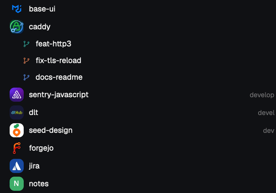
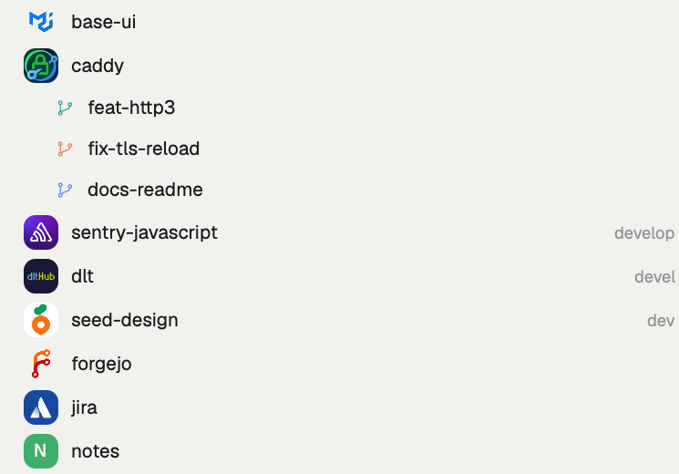

<div align="center">


# spaces-pretty

**A Spaces sidebar for [Herdr](https://herdr.dev) that shows who owns what.**

[](LICENSE)
[](https://herdr.dev/mods)
[](#)



</div>

When you run a dozen agents across a dozen repos, the sidebar turns into a wall of identical letter tiles. spaces-pretty gives every space a face.

<table>
<tr>
<td align="center"><b>Dark</b><br></td>
<td align="center"><b>Light</b><br></td>
</tr>
</table>

## What you get

- **The owner's picture as the icon.** The org logo or user photo of the repo's `origin`. Works for GitHub, GitLab, Codeberg and Bitbucket.
- **Softly rounded tiles.** 24px with 8px corners, no frame. Pictures are clipped to the same shape.
- **One color per repo.** Letter tiles and worktree branch icons share it, so a repo and its worktrees read as one family (see `caddy` above).
- **Status dot.** A small dot when an agent in that space is blocked or done.
- **Safe fallback.** No supported remote (see `notes` above)? You get a clean colored letter.
- **Yours still wins.** Colors you set yourself (`space.colors`) override the automatic one.

## Install

```sh
git clone https://github.com/cmg8431/herdr-spaces-pretty
cd herdr-spaces-pretty
./install.sh
```

`install.sh` copies the mod, clones your `main` layout as `pretty`, points it at `spaces-pretty`, and switches to it. Shipped mods and layouts are never modified, so Herdr updates will not overwrite it. Run `./install.sh <layout>` to base it on another layout.

Manual install: copy `mods/spaces-pretty/` to `~/.config/herdr-app/mods/` and change `"mod": "spaces"` to `"mod": "spaces-pretty"` in a layout you cloned.

## Settings

Optional. Create `~/.config/herdr-app/spaces-pretty.json`:

```json
{ "size": 24, "radius": 8, "dot": true }
```

| key | default | meaning |
| --- | --- | --- |
| `size` | `24` | tile size in px |
| `radius` | `8` | corner radius; `size / 2` makes a circle, `0` a square |
| `dot` | `true` | show the blocked/done status dot |

Unknown keys are ignored. Edit and re-open the layout to apply.

## Supported hosts

| Host | Picture comes from |
| --- | --- |
| github.com | `github.com/<owner>.png` |
| gitlab.com | GitLab API, group first, then user |
| codeberg.org | `codeberg.org/<owner>.png` |
| bitbucket.org | `bitbucket.org/account/<owner>/avatar/` |

Anything else, including self-hosted servers, keeps the colored letter.

## What it runs and fetches

Nothing hidden:

- `git config --get remote.origin.url` in each space's folder, to find the owner.
- [`fetch-avatar.sh`](mods/spaces-pretty/fetch-avatar.sh) runs `curl` against the host above, once per owner, and saves to `~/.config/herdr-app/avatars/`. Pictures are refreshed after 7 days.

No tokens, no other hosts, no telemetry.

## Limits

- Tested on macOS only.
- `image()` in Herdr mods loads local files only, which is why pictures are downloaded first. A new space shows its letter for a few seconds until the picture arrives.

## How it is built

A clone of Herdr's shipped `spaces` mod (`mod.clone`), with the avatar drawing in `row()` and `check()` changed. See [RECIPE.md](RECIPE.md) to rebuild it from scratch.

## License

Apache-2.0. Based on Herdr's `spaces` mod, see [NOTICE](NOTICE).
