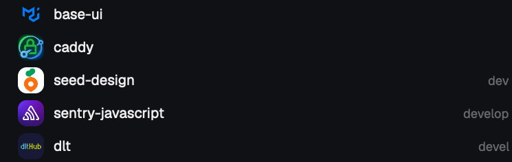

<div align="center">


# spaces-pretty

**A Spaces sidebar for [Herdr](https://herdr.dev) that shows who owns what.**

[](LICENSE)
[](https://herdr.dev/mods)
[](#)



</div>

When you run a dozen agents across a dozen repos, the sidebar turns into a wall of identical letter tiles. spaces-pretty gives every space a face.

- **GitHub owner avatar.** The org logo or user photo of the repo's `origin` becomes the space icon.
- **Softly rounded, no frame.** A 24px tile with 8px corners. Letter tiles take one color per repo, and worktree branch icons share it, so a repo and its worktrees read as one family.
- **Status dot.** A small dot on the avatar when an agent in that space is blocked or done.
- **Tinted worktree rows.** The branch icon of a worktree takes its repo's color.
- **Safe fallback.** No GitHub remote? You get a clean colored letter, like before.
- **Yours still wins.** Colors you set yourself (`space.colors`) override the automatic one.

## Install

```sh
git clone https://github.com/cmg8431/herdr-spaces-pretty
cd herdr-spaces-pretty
./install.sh
```

`install.sh` copies the mod, clones your `main` layout as `pretty`, points it at `spaces-pretty`, and switches to it. Shipped mods and layouts are never modified, so Herdr updates will not overwrite it. Run `./install.sh <layout>` to base it on another layout.

Manual install: copy `mods/spaces-pretty/` to `~/.config/herdr-app/mods/` and change `"mod": "spaces"` to `"mod": "spaces-pretty"` in a layout you cloned.

## What it runs and fetches

Nothing hidden. For each space's folder it runs:

- `git config --get remote.origin.url`, to find the GitHub owner.
- `curl https://github.com/<owner>.png?size=96`, saved to `~/.config/herdr-app/avatars/<owner>.png`. One request per owner, refreshed after 7 days.

No tokens, no other hosts, no telemetry. Delete a file in `avatars/` to refresh it sooner.

## Limits

- Only github.com remotes get a picture. Other hosts keep the colored letter.
- `image()` in Herdr mods loads local files only, which is why avatars are downloaded first.

## How it is built

A clone of Herdr's shipped `spaces` mod (`mod.clone`), with the avatar drawing in `row()` and `check()` changed. See [RECIPE.md](RECIPE.md) to rebuild it from scratch.

## License

Apache-2.0. Based on Herdr's `spaces` mod, see [NOTICE](NOTICE).
