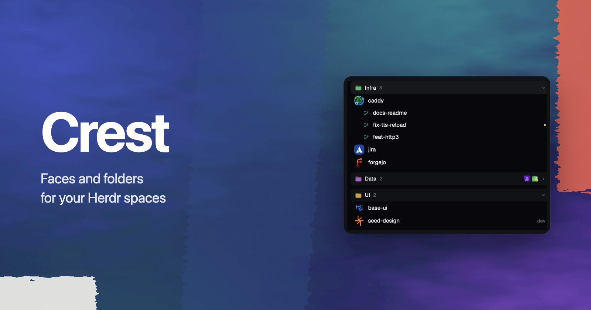

# Crest

A Spaces sidebar where each space shows its project's icon and spaces sit in folders, with busy agents and git state shown quietly under and beside each space.

## What you see

- **Space row**, 30px: a 24px tile with 8px corners (project icon, else owner picture, else a white letter on the repo's color), the name, then a dim tail: repo and branch when unusual, `↑n` `↓n`, a 5px amber dot for uncommitted changes, and `#123` colored by PR state (open green, draft dim, merged violet, closed red).
- **Worktree row**, 28px, under its repo's space: a branch icon in the repo's color.
- **Folder header**, 30px, rounded 8px, a raised background: a filled two-tone folder glyph in the folder's color, the name in the normal text color, the count dim, a chevron on the right. Shut: up to three 15px tiles of who is inside, and a status dot (blocked pulses).
- **Line under a space**, 24px: a thin rail, a status mark (spinner working, pulsing red blocked, green done), the program icon, the agent's title, how long it has been in that state.
- Pinned and folderless spaces come first, without a header.

## How it behaves

- Folder for a space: your folder (by repo, so worktrees follow) > not if you took it out > a rule in `crest.json` > the owner when `group` is `"owner"` > none. Headers show only when there is more than one folder or one of yours.
- Owner folders are named from `api.github.com/users/<owner>` (display name if 24 chars or less) unless you renamed them.
- Colors: yours if set, else a hue from the name, moved to the next palette color so no two folders match.
- Click a header to fold, Alt+click to keep only it open. Drag a header onto another to place it before; onto the space below the last folder to place it last. Drag a space onto a header, among another folder's spaces, or below the last folder to move it.
- Right-click a space: pin, move to a folder, new folder, take out of folder, worktree actions, rename, close. Right-click a folder: rename, color, move up or down, fold the others, unfold all, settings, remove (yours are deleted, automatic ones turned off; spaces stay).
- State lives in shared values `crest.folders`, `crest.order`, `crest.folded`, `crest.pinned`, `crest.loose`, `crest.hidden`, `crest.names`, `crest.colors`, `crest.labels`.
- Spaces are moved (`space.move`) so `Cmd+1..9` follows the sidebar.

## Built from

`mod.clone` of the shipped `spaces` mod (0.1.13). `crest.js`: pure logic (remote parsing, icon choice, config, folders, colors, PR and dirty parsing), tested with `node --test`. `ui.js`: tiles, headers, lines. `menu.js`: the right-click menu, drawn by the same mod opened as a popup with `props.crestMenu`. `fetch-avatar.sh`: owner pictures into `crest-cache/`. Herdr functions used: `spaces`, `panes`, `agents`, `exec`, `shared`/`setShared`, `openOverlay`, `run` (`space.select`, `space.move`, `space.rename`, `space.close`, `pane.focus`).

## Watch out

- `image()` reads files under the Herdr home only, so every picture is copied into `crest-cache/` first.
- Importing from another mod's folder is not allowed; keep the menu inside the mod.
- A new folder in `mods/` without `mod.json` `"place": "none"` gets added to the shown layout as a block.
- There is no mouse-up outside the list; leaving the list ends a drag.
- Model and context use are not in Herdr's agent data, so lines show the title and time only.

## Done when

- A space in a repo with `public/favicon.svg` shows that icon; one with only a GitHub remote shows the owner picture; `~` shows a letter.
- With spaces from two owners, two headers appear, named after the owners; dragging one header onto the other swaps them, and the order survives a restart.
- Dragging a space onto another folder's header moves it there with its worktrees.
- A branch with an open PR shows its number; clicking it opens the PR.
- `node --test` and `herdr-app check mods/crest` pass.
